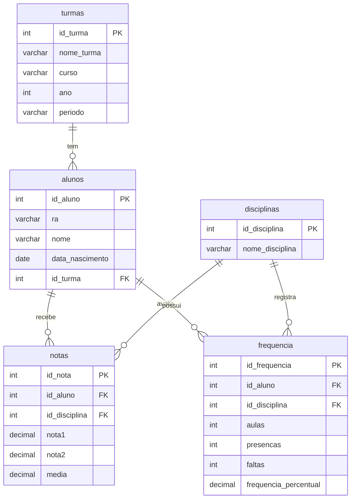

[README (2).md](https://github.com/user-attachments/files/34134316/README.2.md)
# 🎓 Portal Escolar: Banco de Dados Acadêmico


> Estrutura de banco de dados em MySQL para um portal escolar, com turmas, alunos, disciplinas, notas e frequência.

---

## 📋 Sumário

- [Sobre](#-sobre)
- [Funcionalidades](#-funcionalidades)
- [Tecnologias utilizadas](#️-tecnologias-utilizadas)
- [Modelo de dados](#-modelo-de-dados)
- [Como usar](#-como-usar)
- [Exemplos de consultas](#-exemplos-de-consultas)
- [Estrutura do repositório](#-estrutura-do-repositório)
- [Limitações e melhorias planejadas](#️-limitações-e-melhorias-planejadas)
- [Licença](#-licença)
- [Autor](#-autor)

---

## 💡 Sobre

O **Portal Escolar** é o banco de dados `portal_escolar`, que guarda as informações acadêmicas básicas de uma instituição de ensino: em que turma cada aluno está, quais disciplinas existem e como cada aluno se saiu em notas e presença.

Este repositório contém o dump do banco em arquivos `.sql`, **um por tabela**. Ele pode servir de base para um sistema web ou mobile de consulta de boletim e frequência, ou como exercício de modelagem e SQL.

> **Estado atual:** os dumps trazem apenas a **estrutura** das tabelas. Ainda não há registros cadastrados.

<!-- Opcional: conte aqui o contexto do projeto (disciplina, trabalho, protótipo de sistema). -->

## ✨ Funcionalidades

- **Cadastro de turmas:** nome da turma, curso, ano e período (por exemplo, noturno).
- **Cadastro de alunos:** RA (registro acadêmico), nome, data de nascimento e turma.
- **Cadastro de disciplinas:** catálogo com o nome de cada disciplina.
- **Registro de notas:** duas notas por aluno em cada disciplina, mais a média.
- **Controle de frequência:** total de aulas, presenças, faltas e percentual de frequência por aluno e disciplina.

### Tabelas

| Tabela | Descrição | Principais colunas |
|---|---|---|
| `turmas` | Turmas da instituição | `id_turma`, `nome_turma`, `curso`, `ano`, `periodo` |
| `alunos` | Alunos matriculados | `id_aluno`, `ra`, `nome`, `data_nascimento`, `id_turma` |
| `disciplinas` | Disciplinas oferecidas | `id_disciplina`, `nome_disciplina` |
| `notas` | Notas por aluno e disciplina | `id_nota`, `id_aluno`, `id_disciplina`, `nota1`, `nota2`, `media` |
| `frequencia` | Presenças por aluno e disciplina | `id_frequencia`, `id_aluno`, `id_disciplina`, `aulas`, `presencas`, `faltas`, `frequencia_percentual` |

## 🛠️ Tecnologias utilizadas

- **MySQL 8.0** (dump gerado na versão 8.0.46)
- **SQL** (DDL e DML)
- **InnoDB** como engine, com charset `utf8mb4` e collation `utf8mb4_0900_ai_ci`
- **mysqldump 10.13** para gerar os arquivos
- **Mermaid** para o diagrama do modelo de dados
- **Git e GitHub** para versionamento

## 🗂️ Modelo de dados

Os relacionamentos abaixo são **lógicos**, deduzidos dos nomes das colunas. O dump atual ainda não declara chaves estrangeiras (veja [Limitações](#️-limitações-e-melhorias-planejadas)).



---

## 🚀 Como usar

### Pré-requisitos

- [MySQL Server 8.0+](https://dev.mysql.com/downloads/mysql/). Os dumps usam a collation `utf8mb4_0900_ai_ci`, que **não existe no MariaDB nem no MySQL 5.7**.
- Cliente `mysql` de linha de comando (vem com o servidor) ou MySQL Workbench.
- [Git](https://git-scm.com) para clonar o repositório.

### 1. Clone o repositório

```bash
git clone https://github.com/SEU-USUARIO/portal-escolar.git
cd portal-escolar
```

### 2. Crie o banco de dados

Os dumps **não** incluem `CREATE DATABASE` nem `USE`, então crie o banco antes:

```sql
CREATE DATABASE portal_escolar CHARACTER SET utf8mb4;
```

### 3. Importe as tabelas

**Linux, macOS ou Git Bash:**

```bash
for t in turmas alunos disciplinas notas frequencia; do
  mysql -u root -p portal_escolar < portal_escolar_$t.sql
done
```

**Windows (PowerShell ou CMD):** o operador `<` não funciona no PowerShell. Dentro do cliente `mysql`, use `SOURCE`:

```sql
USE portal_escolar;
SOURCE C:/caminho/para/portal_escolar_turmas.sql;
SOURCE C:/caminho/para/portal_escolar_alunos.sql;
SOURCE C:/caminho/para/portal_escolar_disciplinas.sql;
SOURCE C:/caminho/para/portal_escolar_notas.sql;
SOURCE C:/caminho/para/portal_escolar_frequencia.sql;
```

### 4. Confira a importação

```sql
USE portal_escolar;
SHOW TABLES;   -- deve listar 5 tabelas
```

### 5. (Opcional) Insira dados de teste

Como as tabelas vêm vazias, este exemplo permite testar as consultas:

```sql
INSERT INTO turmas      VALUES (1, 'ADS-1A', 'Análise e Desenvolvimento de Sistemas', 2026, 'Noturno');
INSERT INTO alunos      VALUES (1, 'RA2026001', 'Maria Souza', '2005-03-14', 1);
INSERT INTO disciplinas VALUES (1, 'Banco de Dados');
INSERT INTO notas       VALUES (1, 1, 1, 8.50, 7.00, 7.75);
INSERT INTO frequencia  VALUES (1, 1, 1, 40, 38, 2, 95.00);
```

## 🔎 Exemplos de consultas

**Quantidade de alunos por turma:**

```sql
SELECT t.nome_turma, COUNT(a.id_aluno) AS total_alunos
FROM turmas t
LEFT JOIN alunos a ON a.id_turma = t.id_turma
GROUP BY t.id_turma, t.nome_turma;
```

**Boletim de notas:**

```sql
SELECT a.nome, d.nome_disciplina, n.nota1, n.nota2, n.media
FROM notas n
JOIN alunos a      ON a.id_aluno = n.id_aluno
JOIN disciplinas d ON d.id_disciplina = n.id_disciplina
ORDER BY a.nome, d.nome_disciplina;
```

**Alunos com frequência abaixo de 75%** (ajuste o limite conforme a regra da sua instituição):

```sql
SELECT a.nome, d.nome_disciplina, f.frequencia_percentual
FROM frequencia f
JOIN alunos a      ON a.id_aluno = f.id_aluno
JOIN disciplinas d ON d.id_disciplina = f.id_disciplina
WHERE f.frequencia_percentual < 75
ORDER BY f.frequencia_percentual;
```

## 📁 Estrutura do repositório

```text
.
├── portal_escolar_turmas.sql        # uma tabela por arquivo (estrutura)
├── portal_escolar_alunos.sql
├── portal_escolar_disciplinas.sql
├── portal_escolar_notas.sql
├── portal_escolar_frequencia.sql
└── README.md
```

## ⚠️ Limitações e melhorias planejadas

O banco está em fase inicial. Pontos que ainda podem evoluir:

- [ ] **Sem chaves estrangeiras.** `alunos.id_turma`, `notas.id_aluno`, `notas.id_disciplina`, `frequencia.id_aluno` e `frequencia.id_disciplina` não têm `FOREIGN KEY`, então o banco não impede registros órfãos.
- [ ] **Chaves primárias sem `AUTO_INCREMENT`.** Os ids precisam ser informados manualmente em cada `INSERT`.
- [ ] **Colunas aceitam `NULL`.** Campos como `nome`, `ra` e `id_aluno` poderiam ser `NOT NULL`, e `ra` poderia ser `UNIQUE`.
- [ ] **Valores calculados armazenados.** `media`, `faltas` e `frequencia_percentual` podem ser derivados de outras colunas e correm o risco de ficar inconsistentes. Uma alternativa é calculá-los em uma view ou em colunas geradas.
- [ ] **Sem vínculo entre turmas e disciplinas.** Não há como saber quais disciplinas pertencem a cada turma, nem qual professor as ministra.
- [ ] **Sem períodos letivos.** Notas e frequência não indicam bimestre, semestre ou ano.
- [ ] **Sem dados.** Os dumps contêm só a estrutura.

Exemplo de como declarar as chaves estrangeiras:

```sql
ALTER TABLE alunos
  ADD CONSTRAINT fk_alunos_turma FOREIGN KEY (id_turma) REFERENCES turmas (id_turma);

ALTER TABLE notas
  ADD CONSTRAINT fk_notas_aluno      FOREIGN KEY (id_aluno)      REFERENCES alunos (id_aluno),
  ADD CONSTRAINT fk_notas_disciplina FOREIGN KEY (id_disciplina) REFERENCES disciplinas (id_disciplina);

ALTER TABLE frequencia
  ADD CONSTRAINT fk_freq_aluno      FOREIGN KEY (id_aluno)      REFERENCES alunos (id_aluno),
  ADD CONSTRAINT fk_freq_disciplina FOREIGN KEY (id_disciplina) REFERENCES disciplinas (id_disciplina);
```

## 📜 Licença

<!-- Escolha uma licença (por exemplo MIT), adicione o arquivo LICENSE e atualize esta seção. -->

Defina a licença do projeto antes de publicá-lo.
