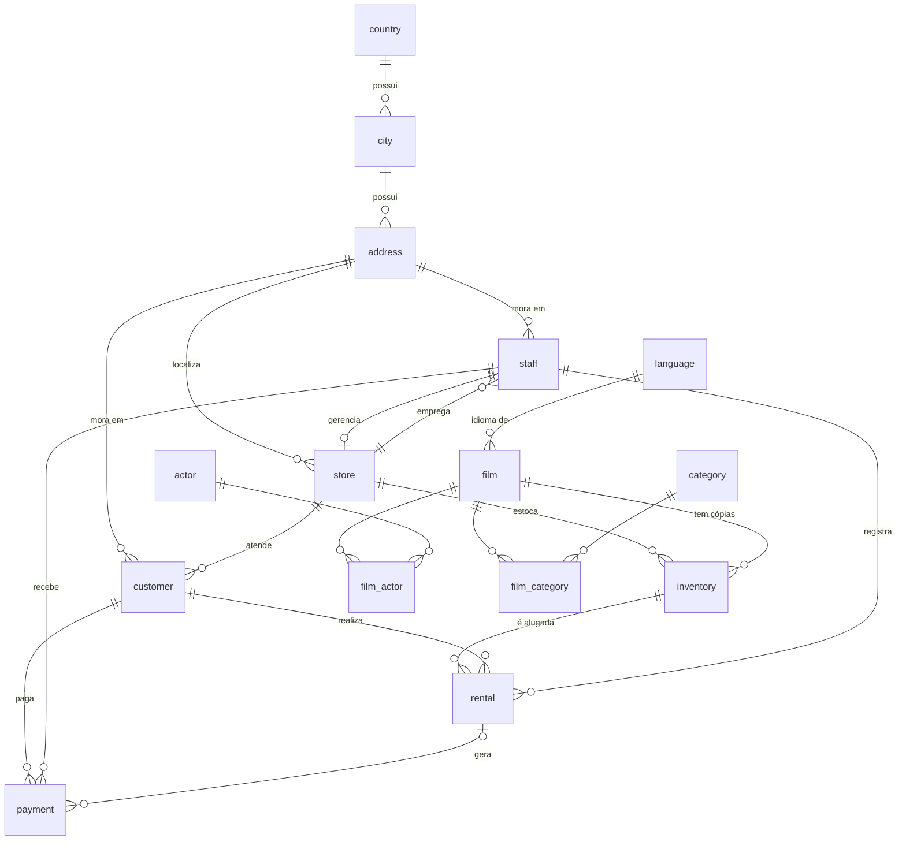

[README (1).md](https://github.com/user-attachments/files/34133392/README.1.md)
# 🎬 Sakila DB: Banco de Dados de Locadora de Filmes


> Dump em SQL do banco **Sakila**, que simula uma rede de locadoras de DVD com filmes, estoque, clientes, aluguéis e pagamentos. Ideal para estudar modelagem relacional e praticar consultas em MySQL.

---

## 📋 Sumário

- [Sobre](#-sobre)
- [Funcionalidades](#-funcionalidades)
- [Tecnologias utilizadas](#️-tecnologias-utilizadas)
- [Modelo de dados](#-modelo-de-dados)
- [Como usar](#-como-usar)
- [Exemplos de consultas](#-exemplos-de-consultas)
- [Estrutura do repositório](#-estrutura-do-repositório)
- [Limitações conhecidas](#️-limitações-conhecidas)
- [Licença](#-licença)
- [Autor](#-autor)

---

## 💡 Sobre

O **Sakila** é um banco de dados de exemplo criado pela equipe do MySQL para ensino e testes. Ele representa uma rede com **duas lojas** de locação de filmes: cada loja tem funcionários, um estoque de cópias e clientes que alugam filmes e pagam por eles.

Este repositório reúne o dump do banco em arquivos `.sql`, **um por tabela**, mais um arquivo com as **views**. Com ele é possível recriar o banco completo (estrutura, dados e relacionamentos) em qualquer servidor MySQL 8.0+ e usá-lo para praticar `JOIN`s, agregações, subconsultas e views.

<!-- Opcional: acrescente aqui o motivo de você ter montado este repositório (disciplina, exercício, estudo). -->

## ✨ Funcionalidades

- **Catálogo de filmes** com 1.000 títulos, 200 atores, 16 categorias e 6 idiomas, ligados por tabelas de relacionamento N:N.
- **Controle de estoque** por loja: 4.581 cópias físicas de filmes distribuídas entre as 2 lojas.
- **Gestão de clientes e funcionários**, com endereço completo (endereço, cidade e país).
- **Histórico de locações e pagamentos**: 16.044 aluguéis e 16.044 pagamentos.
- **Integridade referencial**: 22 chaves estrangeiras garantem a consistência entre as tabelas.
- **7 views prontas** para relatórios:

| View | O que mostra |
|---|---|
| `sales_by_store` | Faturamento total por loja, com o nome do gerente |
| `sales_by_film_category` | Faturamento total por categoria, do maior para o menor |
| `film_list` | Filmes com categoria, preço, duração, classificação e atores |
| `nicer_but_slower_film_list` | Igual à anterior, com nomes dos atores formatados (mais lenta) |
| `actor_info` | Cada ator com seus filmes agrupados por categoria |
| `customer_list` | Clientes com endereço, cidade, país e situação (ativo) |
| `staff_list` | Funcionários com endereço, cidade e país |

### Conteúdo das tabelas

Cerca de **47 mil registros** no total:

| Grupo | Tabela | Registros |
|---|---|---:|
| Catálogo | `film` | 1.000 |
| | `film_text` | 1.000 |
| | `actor` | 200 |
| | `film_actor` | 5.462 |
| | `category` | 16 |
| | `film_category` | 1.000 |
| | `language` | 6 |
| Operação | `store` | 2 |
| | `staff` | 2 |
| | `inventory` | 4.581 |
| | `customer` | 599 |
| | `rental` | 16.044 |
| | `payment` | 16.044 |
| Endereços | `address` | 603 |
| | `city` | 600 |
| | `country` | 109 |

## 🛠️ Tecnologias utilizadas

- **MySQL 8.0** (dump gerado na versão 8.0.46)
- **SQL** (DDL, DML e views)
- **InnoDB** como engine, com charset `utf8mb4` e collation `utf8mb4_0900_ai_ci`
- **mysqldump 10.13** para gerar os arquivos
- **Mermaid** para o diagrama do modelo de dados
- **Git e GitHub** para versionamento

## 🗂️ Modelo de dados



A tabela `film` tem ainda uma segunda chave para `language` (`original_language_id`).

---

## 🚀 Como usar

### Pré-requisitos

- [MySQL Server 8.0+](https://dev.mysql.com/downloads/mysql/). Os dumps usam a collation `utf8mb4_0900_ai_ci`, que **não existe no MariaDB nem no MySQL 5.7**.
- Cliente `mysql` de linha de comando (vem com o servidor) ou MySQL Workbench.
- [Git](https://git-scm.com) para clonar o repositório.

### 1. Clone o repositório

```bash
git clone https://github.com/SEU-USUARIO/SEU-REPOSITORIO.git
cd SEU-REPOSITORIO
```

### 2. Crie o banco de dados

Os dumps **não** incluem `CREATE DATABASE` nem `USE`, então crie o banco antes:

```sql
CREATE DATABASE sakila CHARACTER SET utf8mb4;
```

### 3. Importe as tabelas e depois as views

**Linux, macOS ou Git Bash:**

```bash
for t in actor address category city country customer film film_actor \
         film_category film_text inventory language payment rental staff store; do
  mysql -u root -p sakila < sakila_$t.sql
done

# As views por último, pois dependem de todas as tabelas
mysql -u root -p sakila < sakila_routines.sql
```

**Windows (PowerShell ou CMD):** o operador `<` não funciona no PowerShell. Dentro do cliente `mysql`, use `SOURCE`:

```sql
USE sakila;
SOURCE C:/caminho/para/sakila_actor.sql;
-- repita para cada tabela e termine com:
SOURCE C:/caminho/para/sakila_routines.sql;
```

> A ordem das tabelas não importa, porque cada arquivo desliga a checagem de chaves estrangeiras durante a carga. Só as views precisam vir por último.

### 4. Confira se deu certo

```sql
USE sakila;
SELECT COUNT(*) FROM film;     -- esperado: 1000
SELECT COUNT(*) FROM rental;   -- esperado: 16044
SELECT * FROM sales_by_store;  -- deve listar as 2 lojas
```

## 🔎 Exemplos de consultas

**Faturamento por loja e por categoria** (views prontas):

```sql
SELECT * FROM sales_by_store;
SELECT * FROM sales_by_film_category;
```

**Os 10 filmes mais alugados:**

```sql
SELECT f.title, COUNT(*) AS alugueis
FROM rental r
JOIN inventory i ON i.inventory_id = r.inventory_id
JOIN film f      ON f.film_id = i.film_id
GROUP BY f.film_id, f.title
ORDER BY alugueis DESC
LIMIT 10;
```

**Filmes de uma atriz:**

```sql
SELECT f.title
FROM actor a
JOIN film_actor fa ON fa.actor_id = a.actor_id
JOIN film f        ON f.film_id = fa.film_id
WHERE a.first_name = 'PENELOPE' AND a.last_name = 'GUINESS'
ORDER BY f.title;
```

## 📁 Estrutura do repositório

```text
.
├── sakila_actor.sql           # uma tabela por arquivo (estrutura + dados)
├── sakila_address.sql
├── sakila_category.sql
├── sakila_city.sql
├── sakila_country.sql
├── sakila_customer.sql
├── sakila_film.sql
├── sakila_film_actor.sql
├── sakila_film_category.sql
├── sakila_film_text.sql
├── sakila_inventory.sql
├── sakila_language.sql
├── sakila_payment.sql
├── sakila_rental.sql
├── sakila_staff.sql
├── sakila_store.sql
├── sakila_routines.sql        # as 7 views (importar por último)
└── README.md
```

## ⚠️ Limitações conhecidas

- **Sem triggers, procedures ou functions.** Apesar do nome, `sakila_routines.sql` contém só as views. Na versão oficial do Sakila, triggers mantêm `film_text` sincronizada com `film`; aqui isso não acontece.
- **Views com `DEFINER=root@localhost`.** Ao importar com outro usuário, pode ser necessário ajustar o `DEFINER` ou ter privilégios elevados.
- **Dados fictícios.** Nomes, endereços e valores não representam pessoas ou negócios reais.

## 📜 Licença

O banco Sakila foi criado pela equipe do MySQL e é distribuído com licença BSD. Confira os termos atuais na [documentação oficial](https://dev.mysql.com/doc/sakila/en/) antes de redistribuir.
